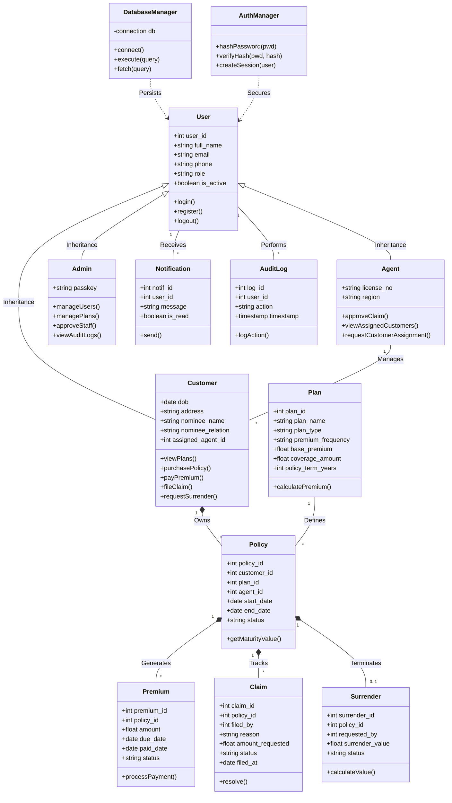

# Class Diagram - Insurance Management System

A class diagram represents the static structure of a system by showing the classes, their attributes, operations, and the relationships among them. It models the system in terms of classes, where each class defines a set of objects having similar properties (attributes) and behaviors (methods). It also shows different types of relationships such as association, inheritance, aggregation, and dependency between classes.

Class diagrams are an important part of object-oriented design, as they provide a clear blueprint of how the system is organized. They help developers understand the structure of the system and serve as a foundation for coding and implementation.

## 1. Static Class Diagram

## 2. Class Definitions & Responsibilities

| Class Category | Primary Responsibility |
| :--- | :--- |
| **User Models** | Encapsulate user profile data and role-specific business logic (e.g., bidding for Agents, paying for Customers). |
| **Insurance Models** | Define the parameters of insurance products (`Plan`) and the legal contracts (`Policy`) binding users to them. |
| **Financial Models** | Manage the lifecycle of money movement, specifically `Premium` schedules and `Claim` payouts. |
| **Service Managers** | Stateless or singleton classes that handle system-wide utilities like database access and authentication security. |

## 3. Relationship Explanations

1. **Inheritance (Is-A)**: `Customer`, `Agent`, and `Admin` are specialized versions of the `User` class, inheriting common attributes like `email` and methods like `login()`.
2. **Composition (Has-A)**: A `Policy` is a composite object that owns its `Premium` schedule and associated `Claim` or `Surrender` records. If a policy is deleted, its financial history is removed.
3. **Association (Works-With)**: `Agents` manage multiple `Customers`. This is a loose association where a customer is assigned to an agent for service.
4. **Dependency (Uses)**: `DatabaseManager` and `AuthManager` provide infrastructure services used by the entity classes for persistence and security.
5. **Multiplicity**:
    *   **1 to ***: A single instance (e.g., Customer) can be associated with multiple instances (e.g., Policy).
    *   **1 to 0..1**: A policy may have zero or one surrender request.
