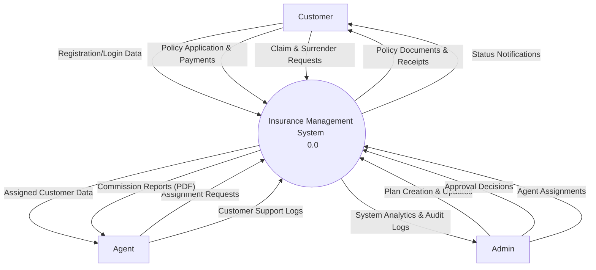
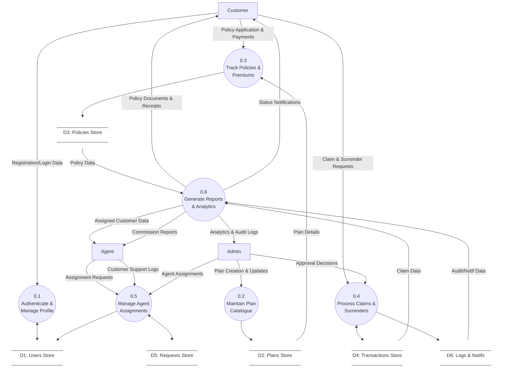
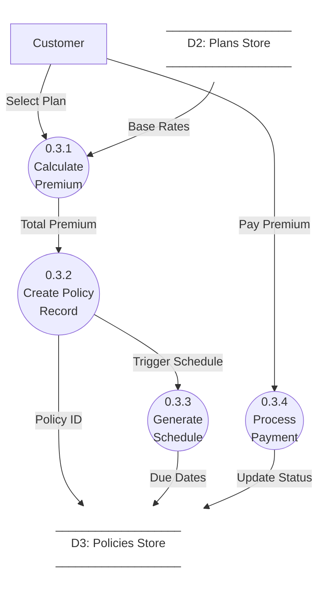
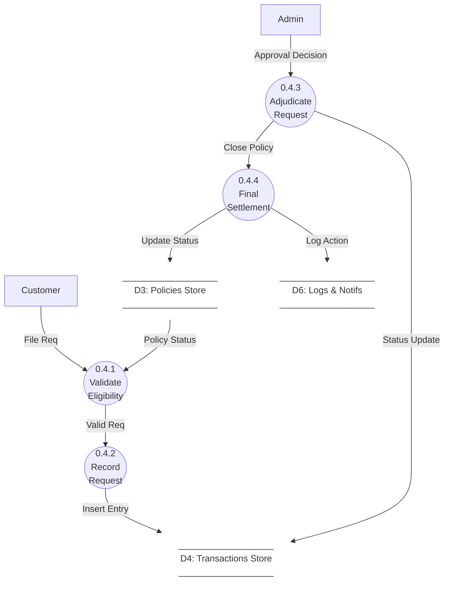
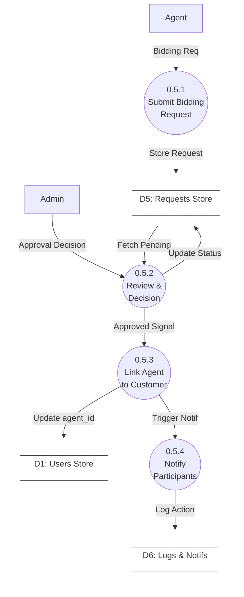

# Data Flow Diagram (DFD) - Insurance Management System

This document outlines the flow of data within the Insurance Management System (IMS) according to standard Software Engineering principles.

## 0. Core Data Entities

The following entities represent the primary data structures persisted in the system.

| Data Item | Definition |
| :--- | :--- |
| **Credentials** | email + password_hash + role |
| **User Profile** | full_name, phone, dob, address, etc. |
| **Plan Details** | plan_name, type, coverage, base_premium, frequency |
| **Policy Data** | customer_id, plan_id, agent_id, start_date, end_date, status |
| **Premium Schedule** | List of (due_date, amount, status) |
| **Payment Info** | premium_id, paid_date, method (simulated) |
| **Claim/Surrender Req** | policy_id, reason, amount_requested, status, filed_at |
| **Approval Remark** | status_change (approved/rejected) + admin_note |
| **Assignment Req** | agent_id, customer_id, status |
| **Audit Entry** | user_id, action, timestamp |
| **Notification** | user_id, message, timestamp |

---

## DFD Level 0: Context Diagram
**Goal**: Establish the context of the system (Users and Data I/O).

### Level 0: Data Flow Dictionary

| Data Flow | Content / Elements |
| :--- | :--- |
| **Registration/Login Data** | `full_name + email + password + phone + address + dob + role` |
| **Policy Application** | `customer_id + plan_id + duration + frequency + initial_payment` |
| **Claim & Surrender Req** | `policy_id + request_type + reason + supporting_info` |
| **Policy Docs & Receipts** | `policy_record + premium_schedule + payment_receipt (PDF)` |
| **Status Notifications** | `message_body + timestamp + priority_level` |
| **Assignment Requests** | `agent_id + customer_id + bidding_note` |
| **Approval Decisions** | `request_id + status (Approved/Rejected) + admin_remark` |
| **Analytics & Audit Logs** | `system_usage_stats + financial_summaries + user_activity_trail` |

---

## DFD Level 1: System Decomposition
**Goal**: Decompose the Level 0 bubble into major processes. All external entities and data stores are shown. Balancing with Level 0 is maintained.

### Level 1: Data Flow Dictionary

| Data Flow | Content / Elements |
| :--- | :--- |
| **Credentials** | `email + hashed_password + user_role` |
| **Plan Config** | `name + type + base_premium + coverage_amount + tenure` |
| **Update Catalogue** | `structured_plan_object (for D2 storage)` |
| **Plan Details** | `plan_id + rate_table + eligibility_criteria` |
| **Buy Plan / Pay Premium**| `customer_id + amount + payment_token + policy_meta` |
| **Create Policy** | `policy_id + start_date + end_date + agent_id` |
| **Receipt Data** | `transaction_id + amount_paid + balance_due` |
| **Decision** | `admin_user_id + target_id + action_type` |
| **Log Request** | `source_process + timestamp + data_diff` |
| **Update Linkage** | `customer_id + new_agent_id` |

---

## DFD Level 2: Detailed Processes

### 2.1 Process 0.3: Policy & Premium Lifecycle
**Balancing**: Matches Input/Output of L1 Process 0.3.

### 2.2 Process 0.4: Claims & Surrender Workflow
**Balancing**: Matches Input/Output of L1 Process 0.4.

### 2.3 Process 0.5: Agent Assignment Management
**Balancing**: Matches Input/Output of L1 Process 0.5.

### Level 2: Data Flow Dictionary (Internal)

| Data Flow | Content / Elements |
| :--- | :--- |
| **Base Rates** | `plan_base_price + age_multiplier + tenure_factor` |
| **Total Premium** | `(base_rate * frequency_index) + taxes` |
| **Trigger Schedule** | `policy_start_date + frequency (Monthly/Yearly)` |
| **Due Dates** | `List of upcoming_payment_dates` |
| **Valid Req** | `request_id + validation_flag (True/False)` |
| **Approved Signal** | `authorized_admin_id + approval_timestamp` |
| **Bidding Note** | `agent_experience + justification_text` |
| **Update agent_id** | `agent_request_id -> confirmed_agent_id` |

## Key Data Stores Mapping

| Store ID | Name | Database Tables |
| :--- | :--- | :--- |
| **D1** | Users Store | `users`, `agents`, `customers` |
| **D2** | Plans Store | `plans` |
| **D3** | Policies Store | `policies`, `premiums` |
| **D4** | Transactions Store | `claims`, `surrenders` |
| **D5** | Requests Store | `agent_requests` |
| **D6** | Logs & Notifs | `audit_log`, `notifications` |
