# Object Diagram - Insurance Management System

This document provides a snapshot of the Insurance Management System's state, illustrating how specific instances of classes interact at a given moment.

## 1. System State Snapshot (Object Diagram)

The following diagram represents a scenario where an Agent (**John**) manages a Customer (**Alice**), who has purchased a **Life Secure** policy.

```mermaid
graph TD
    %% Instances (Objects) with rounded corners
    Admin("<u>SuperAdmin : Admin</u><br/>id = 1<br/>email = admin@ims.com<br/>status = Active")
    
    Agent("<u>John : Agent</u><br/>agent_id = 2<br/>user_id = 2<br/>region = North Zone<br/>license_no = LIC-7744")
    
    Customer("<u>Alice : Customer</u><br/>cust_id = 10<br/>user_id = 10<br/>address = 123 Maple St, NY<br/>assigned_agent_id = 2")
    
    Plan("<u>LifeSecure : Plan</u><br/>plan_id = 101<br/>plan_name = Life Secure Plus<br/>plan_type = Life<br/>base_premium = 1200.0<br/>coverage_amount = 500000.0")
    
    Policy("<u>POL-5001 : Policy</u><br/>policy_id = 5001<br/>customer_id = 10<br/>plan_id = 101<br/>agent_id = 2<br/>start_date = 2024-01-15<br/>status = Active")
    
    Premium1("<u>PREM-9001 : Premium</u><br/>premium_id = 9001<br/>policy_id = 5001<br/>due_date = 2024-02-15<br/>amount = 1200.0<br/>status = Paid")
    
    Premium2("<u>PREM-9002 : Premium</u><br/>premium_id = 9002<br/>policy_id = 5001<br/>due_date = 2024-03-15<br/>amount = 1200.0<br/>status = Due")

    %% Relationships between instances
    Agent ---|Manages| Customer
    Customer ---|Holds| Policy
    Plan ---|Defines| Policy
    Policy ---|Contains| Premium1
    Policy ---|Contains| Premium2
    
    %% Styling
    style Admin fill:#1c2330,stroke:#30363d
    style Agent fill:#1c2330,stroke:#30363d
    style Customer fill:#1c2330,stroke:#30363d
    style Plan fill:#1c2330,stroke:#30363d
    style Policy fill:#1c2330,stroke:#30363d
    style Premium1 fill:#1c2330,stroke:#30363d
    style Premium2 fill:#1c2330,stroke:#30363d
```

## 2. Scenario Details

| Object Instance | Context |
| :--- | :--- |
| **Admin: SuperAdmin** | Currently logged in and monitoring system logs. |
| **Agent: John** | Assigned to Alice after a successful bidding request. |
| **Customer: Alice** | Purchased the LifeSecure plan last month. |
| **Policy: POL-5001** | The active contract resulting from Alice's application. |
| **Premium: PREM-9001** | The first installment, already paid by Alice. |
| **Premium: PREM-9002** | The upcoming installment, currently marked as 'Due'. |

## 3. Difference from Class Diagram
Unlike the Class Diagram which shows the **blueprint** (all possible interactions), this Object Diagram shows a **concrete example**:
- **Values** are assigned to attributes (e.g., `status = "Active"` instead of `string status`).
- **Specific Counts** are visible (e.g., one policy and two specific premiums).
- **Linkage** is specific (e.g., Alice is linked to John, not just any Agent).
