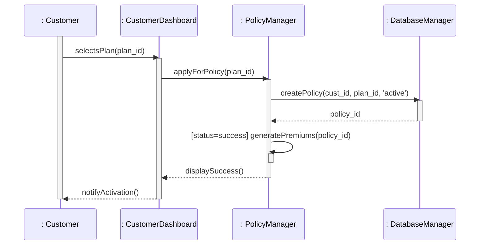
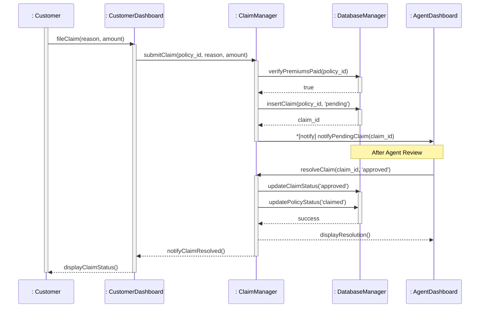

# Sequence Diagrams - Insurance Management System (IMS)

Following Rajib Mall's methodology, these diagrams represent specific scenarios through the system, emphasizing object lifelines, activation boxes, and synchronous/asynchronous messaging.

## 1. Scenario: Successful Policy Purchase (Main Success Scenario)

This scenario illustrates the process of a customer browsing, selecting, and successfully activating a new insurance policy.

## 2. Scenario: Claim Submission and Approval

This scenario tracks the lifecycle of a claim from customer submission through agent adjudication and final resolution.

## 3. Objects & Responsibilities

| Object : Class | Role | Responsibility |
| :--- | :--- | :--- |
| **: Customer** | Actor Instance | Initiates transactions and receives notifications. |
| **: CustomerDashboard** | Boundary | Provides the interface for plan selection and claim filing. |
| **: PolicyManager** | Controller | Handles business logic for policy creation and premium generation. |
| **: ClaimManager** | Controller | Validates claim eligibility and routes to adjudication. |
| **: DatabaseManager** | Entity | Persists state and performs CRUD operations on tables. |
| **: AgentDashboard** | Boundary | Interface for agents to review and approve/reject claims. |

## 4. Academic UML Rules Followed (Rajib Mall)

1.  **Object Representation**: All lifelines represent instances (objects), not classes. Names are formatted as `objectName : ClassName`.
2.  **Activation Boxes**: Thin rectangles (Focus of Control) indicate when an object is active. The **Customer** is active throughout the entire session.
3.  **Message Types**: 
    *   **Synchronous**: Solid lines with filled arrowheads (`->>`).
    *   **Asynchronous**: Used for notifications or parallel tasks (`->`).
    *   **Return**: Dashed lines used when control return is not obvious (`-->>`).
4.  **Guard Conditions**: Conditions like `[status=success]` are used for conditional logic.
5.  **Iteration**: The asterisk `*` indicates repeated messages (e.g., notifying all relevant agents).
6.  **Scenario Scope**: Each diagram focuses on a single successful execution path for clarity.
